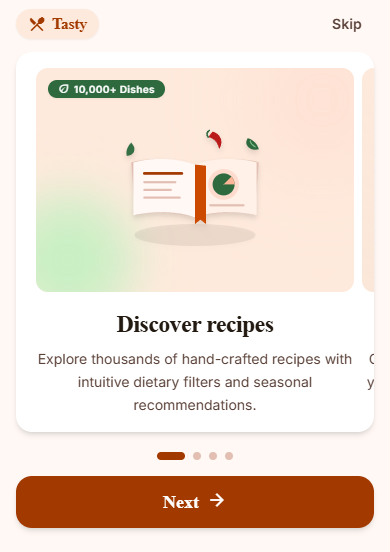
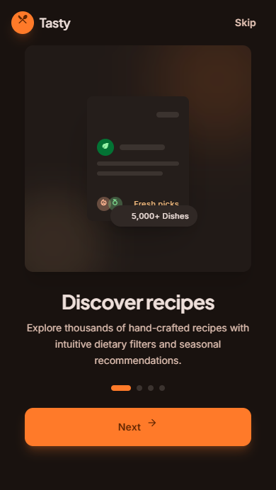
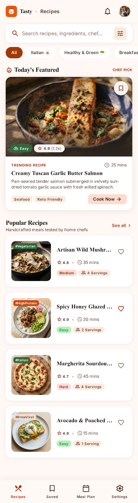
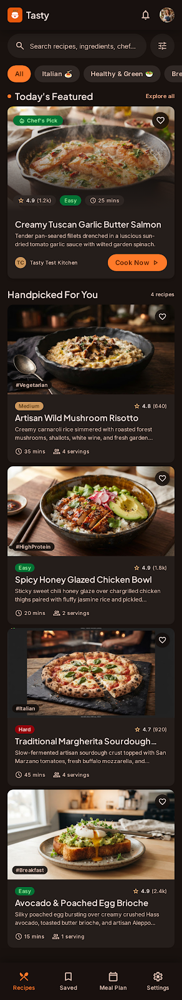
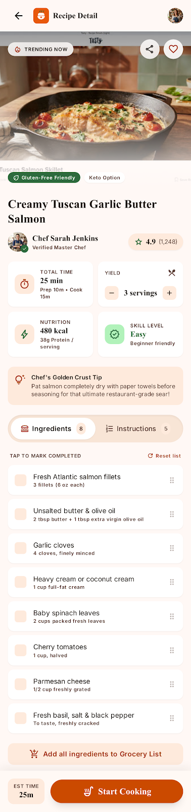
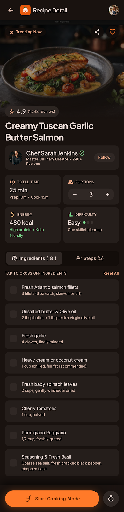
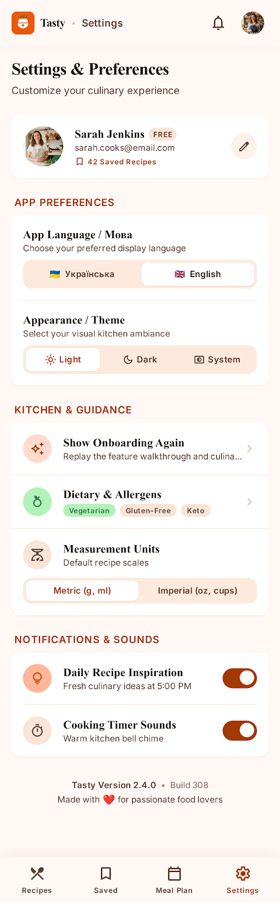
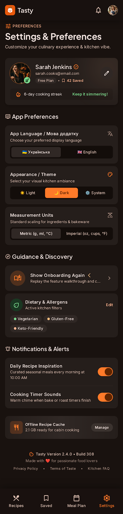

# Tasty — додаток рецептів на Kotlin Multiplatform (Лабораторна робота №4)

**Tasty** — це мультиплатформний клієнтський додаток, розроблений за допомогою технологій **Kotlin Multiplatform** та **Compose Multiplatform** для платформ **Android**, **iOS** та **Desktop (JVM)**. Проєкт є основою майбутнього повноцінного REST API клієнта для пошуку, перегляду та збереження кулінарних рецептів.

---

## Предметна область та API

- **Предметна область**: кулінарні рецепти (`RECIPES`).
- **Цільовий REST API**: [`https://dummyjson.com/recipes`](https://dummyjson.com/recipes).
- **Поточний обсяг реалізації**: у цій лабораторній роботі реалізовано архітектуру проєкту, кастомну тему оформлення Material 3, шрифти, логування, збереження налаштувань користувача, екран онбордингу та локалізацію інтерфейсу (мережевий шар буде додано в наступних лабораторних роботах).

---

## Реалізовані пункти лабораторної

1. **Проєкт на Kotlin Multiplatform та Compose Multiplatform**: створено єдиний спільний модуль `:composeApp` (пакет `com.example.tasty`) із підтримкою таргетів Android, iOS та Desktop. Конфігурацію залежностей і плагінів організовано через каталог версій [`gradle/libs.versions.toml`](gradle/libs.versions.toml) та скрипт збірки [`composeApp/build.gradle.kts`](composeApp/build.gradle.kts).
2. **Кастомна тема Material 3**: налаштовано світлу й темну палітри кольорів (`#E8590C`, `#2F6B3F`, `#FFF8F1`, `#1C1410`, `#FFFFFF`, `#261C16`, `#2B2118`), шрифти **Poppins** (заголовки) та **Inter** (основний текст) із локальних файлів у `composeApp/src/commonMain/composeResources/font/`, а також форми із заокругленням `16.dp`. Файли теми розташовані в [`Color.kt`](composeApp/src/commonMain/kotlin/com/example/tasty/ui/theme/Color.kt), [`Type.kt`](composeApp/src/commonMain/kotlin/com/example/tasty/ui/theme/Type.kt), [`Shape.kt`](composeApp/src/commonMain/kotlin/com/example/tasty/ui/theme/Shape.kt) та [`Theme.kt`](composeApp/src/commonMain/kotlin/com/example/tasty/ui/theme/Theme.kt).
3. **Логування подій через Kermit**: створено спільний об'єкт логування без використання сторонніх DI-фреймворків, який записує запуск додатка, навігацію по слайдах онбордингу та зміни призначених для користувача налаштувань. Реалізація міститься у файлі [`composeApp/src/commonMain/kotlin/com/example/tasty/util/logging/AppLogger.kt`](composeApp/src/commonMain/kotlin/com/example/tasty/util/logging/AppLogger.kt).
4. **Збереження налаштувань через multiplatform-settings**: реалізовано клас `UserPreferences`, який зберігає прапорець проходження онбордингу (`onboardingCompleted`), обрану мову інтерфейсу (`language`: `"system"`, `"uk"`, `"en"`) та режим теми (`themeMode`: `"system"`, `"light"`, `"dark"`). Код збереження налаштувань розташований у [`composeApp/src/commonMain/kotlin/com/example/tasty/data/settings/UserPreferences.kt`](composeApp/src/commonMain/kotlin/com/example/tasty/data/settings/UserPreferences.kt).
5. **Екран онбордингу на основі HorizontalPager**: реалізовано 4 слайди з іконками, заголовками, описами, анімованими індикаторами сторінок, кнопкою пропуску та кнопкою переходу далі з плавною анімацією прокручування через `ViewModel`. Код розміщено у файлах [`OnboardingPage.kt`](composeApp/src/commonMain/kotlin/com/example/tasty/ui/onboarding/OnboardingPage.kt), [`OnboardingViewModel.kt`](composeApp/src/commonMain/kotlin/com/example/tasty/ui/onboarding/OnboardingViewModel.kt), [`OnboardingScreen.kt`](composeApp/src/commonMain/kotlin/com/example/tasty/ui/onboarding/OnboardingScreen.kt) та [`HomeScreen.kt`](composeApp/src/commonMain/kotlin/com/example/tasty/ui/home/HomeScreen.kt).
6. **Локалізація інтерфейсу (uk/en)**: усі текстові рядки винесено в мультиплатформні ресурси, а перемикання між системною, українською та англійською мовами відбувається миттєво під час роботи додатка. Ресурси та менеджер локалі містяться у [`values/strings.xml`](composeApp/src/commonMain/composeResources/values/strings.xml), [`values-uk/strings.xml`](composeApp/src/commonMain/composeResources/values-uk/strings.xml) та [`LocaleManager.kt`](composeApp/src/commonMain/kotlin/com/example/tasty/data/settings/LocaleManager.kt).

---

## Використані бібліотеки

- **Kermit (`co.touchlab:kermit`)**: використовується для мультиплатформного логування життєвого циклу додатка, дій користувача під час онбордингу та змін налаштувань у спільній кодовій базі `commonMain`.
- **multiplatform-settings (`com.russhwolf:multiplatform-settings` та `multiplatform-settings-no-arg`)**: використовується для постійного збереження налаштувань користувача (статусу онбордингу, обраної мови та теми оформлення) у нативному сховищі кожної платформи (`SharedPreferences`, `NSUserDefaults`, `java.util.prefs.Preferences`).

---

## Локалізація

Усі видимі для користувача текстові рядки зберігаються в ресурсах **Compose Multiplatform**:
- **Англійська мова (за замовчуванням)**: [`composeApp/src/commonMain/composeResources/values/strings.xml`](composeApp/src/commonMain/composeResources/values/strings.xml).
- **Українська мова (`uk`)**: [`composeApp/src/commonMain/composeResources/values-uk/strings.xml`](composeApp/src/commonMain/composeResources/values-uk/strings.xml).

Перемикання мови в рантаймі реалізовано за допомогою механізму `expect`/`actual` у файлі [`LocaleManager.kt`](composeApp/src/commonMain/kotlin/com/example/tasty/data/settings/LocaleManager.kt) (`applyPlatformLanguage` та `@Composable ProvideAppLocale`):
- **Android** ([`LocaleManager.android.kt`](composeApp/src/androidMain/kotlin/com/example/tasty/data/settings/LocaleManager.android.kt)): оновлює `Locale.setDefault(...)`, викликає `AppCompatDelegate.setApplicationLocales(...)` та передає локалізований контекст через `CompositionLocalProvider(LocalConfiguration, LocalContext)`.
- **iOS** ([`LocaleManager.ios.kt`](composeApp/src/iosMain/kotlin/com/example/tasty/data/settings/LocaleManager.ios.kt)): записує обраний код мови до ключа `AppleLanguages` у `NSUserDefaults.standardUserDefaults` та ініціює рекомпозицію інтерфейсу через `key(languageCode)`.
- **Desktop** ([`LocaleManager.desktop.kt`](composeApp/src/desktopMain/kotlin/com/example/tasty/data/settings/LocaleManager.desktop.kt)): встановлює обрану локаль через `Locale.setDefault(...)` та оновлює стан дерева композиції за допомогою `key(languageCode)`.

---

## Дизайн

Дизайн інтерфейсу створено в **Google Stitch**. Повна специфікація дизайн-системи описана у файлах [`docs/design/DESIGN.md`](docs/design/DESIGN.md) (світлий варіант) та [`docs/design/design-dark.md`](docs/design/design-dark.md) (темний варіант), а експортовані HTML-макети збережено в директорії [`docs/design/html/`](docs/design/html/).

- **Кольорова палітра**:
  - **Основний колір (`primary`)**: `#E8590C` (насичений теракотово-помаранчевий).
  - **Додатковий колір (`secondary`)**: `#2F6B3F` (трав'яний темно-зелений).
  - **Світла тема**: фон `#FFF8F1`, поверхня `#FFFFFF`, текст на фоні `#2B2118`.
  - **Темна тема**: фон `#1C1410`, поверхня `#261C16`, світлий текст на темному фоні `#F5ECE4`.
- **Шрифти**: **Poppins** (`Regular`, `SemiBold`, `Bold`) для заголовків і акцентів та **Inter** (`Regular`, `Medium`, `SemiBold`) для основного тексту, списків інгредієнтів і підписів.

---

## Скриншоти інтерфейсу

| Екран | Світла тема | Темна тема |
| :--- | :---: | :---: |
| **Онбординг** |  |  |
| **Головний екран** |  |  |
| **Деталі рецепта** |  |  |
| **Налаштування** |  |  |

---

## Збірка та запуск

### 1. Android
Щоб зібрати відлагоджувальний APK-файл, виконайте команду:
```bash
./gradlew :composeApp:assembleDebug
```

### 2. Desktop (JVM)
Щоб запустити десктопну версію додатка, виконайте команду:
```bash
./gradlew :composeApp:run
```

### 3. iOS
Відкрийте `iosApp` у Xcode і запустіть на симуляторі (потрібен macOS).
